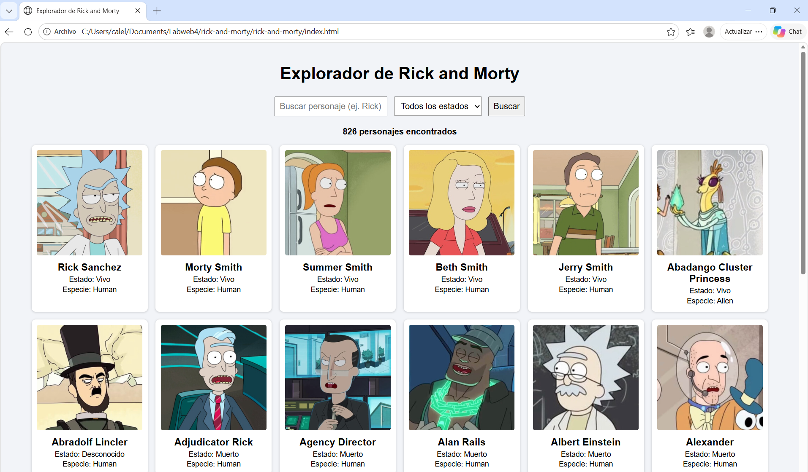
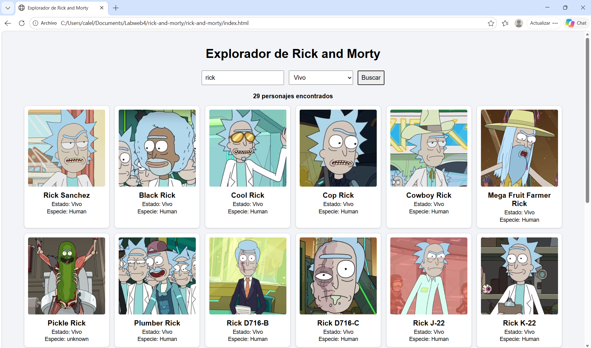
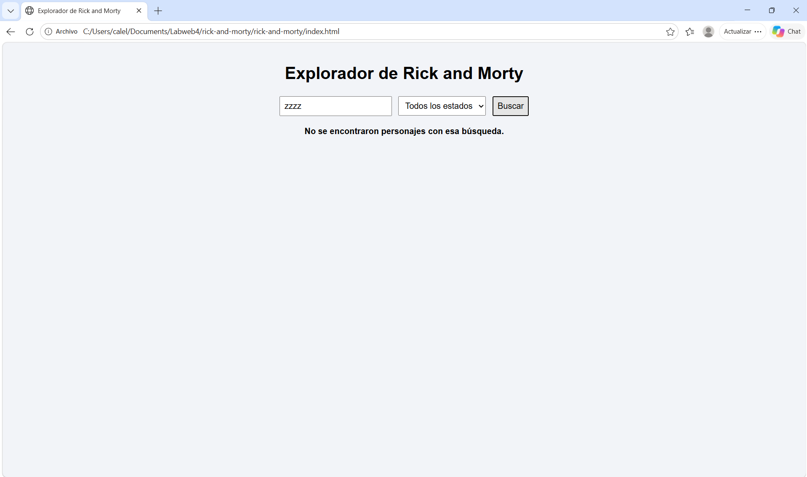
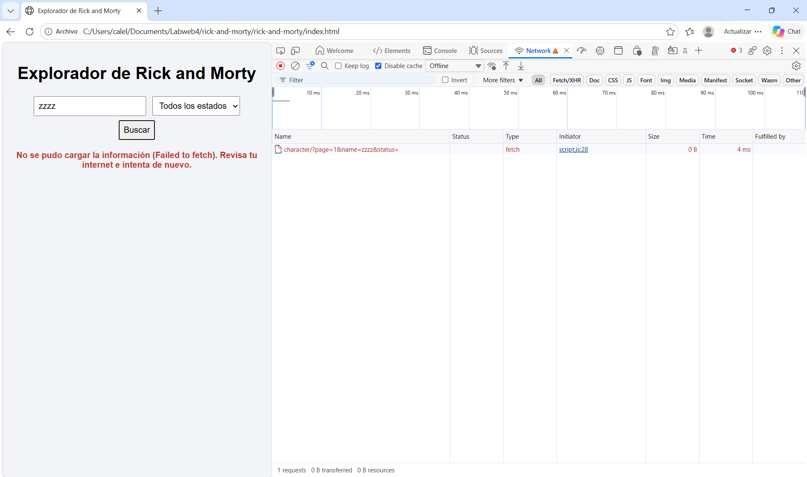

# Explorador de Rick and Morty

Aplicación web que consume una API pública para buscar personajes de la serie Rick and Morty. Proyecto de la **Actividad 4** del Laboratorio de Programación Web (FIME, UANL).

## URL de la aplicación

https://004sdffgh.github.io/rick-and-morty/

## Tecnologías

- HTML5 y CSS3 (Flexbox para las tarjetas).
- JavaScript ES6+: `fetch()`, `async/await`, `try/catch` y creación de elementos con el DOM.
- JSON como formato de respuesta de la API.
- Git, GitHub y GitHub Pages.

## API utilizada

The Rick and Morty API (https://rickandmortyapi.com). Es una API pública y gratuita que no necesita llave ni datos personales. Devuelve en formato JSON la información de los personajes de la serie.

## Endpoint

```
GET https://rickandmortyapi.com/api/character/?page=1&name=rick&status=alive
```

| Parámetro | Descripción |
|---|---|
| page | Número de página (20 personajes por página) |
| name | Filtra por nombre |
| status | Filtra por estado: alive, dead o unknown |

Respuesta: un JSON con info (total de resultados y de páginas) y results (arreglo de personajes con nombre, estado, especie e imagen).

## Estados y manejo de errores

- **Cargando:** mientras llega la respuesta se muestra "Cargando personajes...".
- **Resultado vacío:** la API responde 404 cuando la búsqueda no tiene resultados; se muestra "No se encontraron personajes con esa búsqueda."
- **Error:** si no hay internet o el servidor responde con otro código (por ejemplo 500), `try/catch` muestra un aviso en rojo.

Códigos de error posibles: 404 cuando la búsqueda no tiene resultados, y otros códigos (por ejemplo 500) si falla el servidor.

## Instrucciones de uso

1. Abrir la URL de la aplicación; al cargar aparecen los primeros personajes.
2. Escribir un nombre y presionar Buscar (o Enter).
3. Elegir un estado en el menú para filtrar.
4. Usar Anterior y Siguiente para cambiar de página.

## Capturas


### Resultados al abrir la página



### Búsqueda con filtro de estado



### Búsqueda sin resultados



### Mensaje de error sin conexión



## Reflexión técnica

En esta actividad aprendí a pedir datos a una API con fetch y async/await y a convertir la respuesta a JSON para mostrarla en la página creando las tarjetas con el DOM. Lo que más me costó fue manejar los casos especiales: la API responde con un error 404 cuando una búsqueda no tiene resultados, así que no lo traté como una falla sino como un resultado vacío con su propio mensaje. Para los errores de verdad (sin internet o fallas del servidor) usé try/catch y muestro un aviso claro. También agregué un mensaje de "Cargando" mientras llega la respuesta. Si siguiera mejorando la aplicación, agregaría una ventana con más datos de cada personaje.
